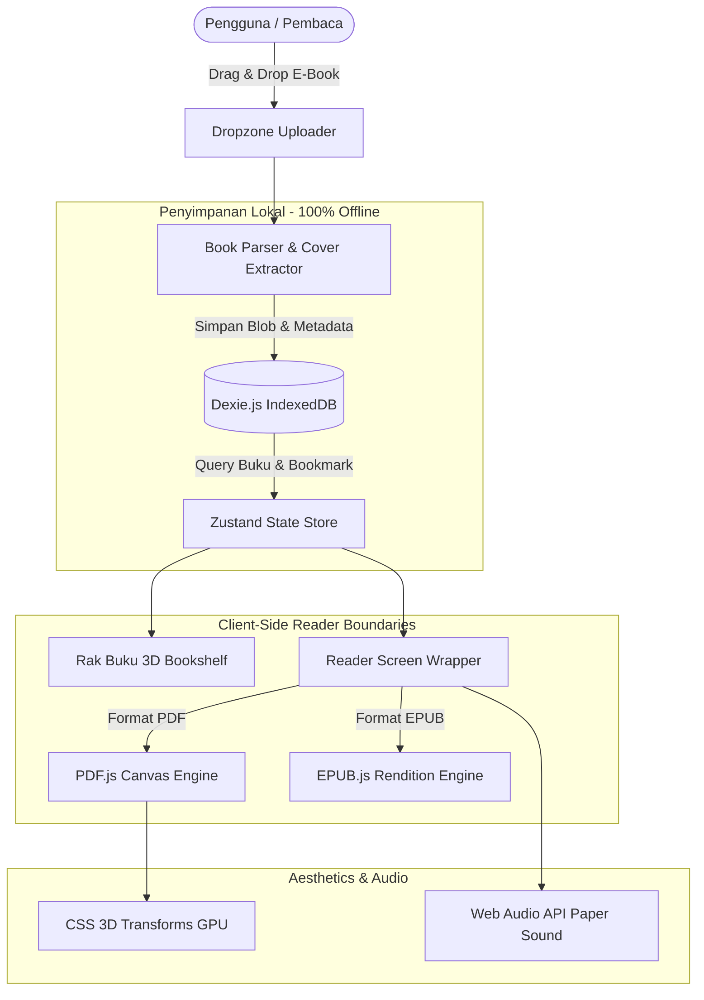

# LuminaRead 📖✨

> **Modern, High-Performance Offline-First E-Book Reader** supporting PDF & EPUB with realistic 3D page animations, local library management, and distraction-free Zen mode.

[](https://nextjs.org)
[](https://react.dev)
[](https://www.typescriptlang.org)
[](https://tailwindcss.com)
[](https://dexie.org)
[](LICENSE)

---

## 🌟 Deskripsi Singkat

**LuminaRead** adalah aplikasi pembaca buku digital (*e-book reader*) berbasis *offline-first* yang mendukung berbagai format dokumen seperti **PDF** dan **EPUB**. Aplikasi ini dirancang untuk memberikan pengalaman membaca yang bebas gangguan (*distraction-free*), dilengkapi dengan manajemen rak buku pribadi, ekstraksi sampul otomatis, penyimpanan progres membaca lokal, efek animasi halaman 3D yang memukau, serta kustomisasi tampilan layar agar nyaman dibaca kapan saja.

---

## 🎯 Latar Belakang & Solusi

* **Latar Belakang Masalah:** Banyak pembaca memiliki koleksi *e-book* dalam berbagai format (PDF dan EPUB) yang tersebar di penyimpanan perangkat, sehingga sulit melacak halaman terakhir yang dibaca atau mengatur tampilan bacaan agar nyaman di mata tanpa harus bergantung pada pembaca bawaan yang kaku.
* **Solusi yang Ditawarkan:** Membangun aplikasi pembaca terpadu yang ringan dan berjalan langsung di peramban/perangkat tanpa perlu mengunggah file ke server eksternal, sehingga **menjaga privasi 100%** sekaligus tetap bisa digunakan kapan saja tanpa koneksi internet (*PWA-ready*).

---

## ⚡ Fitur Utama

### 1. 📚 Dukungan Multi-Format (PDF & EPUB)
* **Mesin PDF Terakselerasi:** Merender dokumen PDF dengan resolusi tajam (HiDPI Retina support) menggunakan `pdfjs-dist` dengan *dedicated background web worker*.
* **Mesin EPUB Fleksibel:** Kontainer baca adaptif (*reflowable*) menggunakan `epubjs`, mendukung navigasi bab, daftar isi (*Table of Contents*), dan penyesuaian teks dinamis.

### 2. 🗄️ Rak Buku Digital (Personal Library)
* **Drag-and-Drop Uploader:** Cukup seret dan lepaskan file `.pdf` atau `.epub` ke rak buku.
* **Ekstraksi Sampul Otomatis:** Otomatis membaca halaman pertama atau metadata berkas untuk membuat thumbnail cover beresolusi tinggi. Dilengkapi juga dengan *procedural artistic cover generator* untuk e-book tanpa gambar cover.
* **Kartu Buku 3D:** Kartu buku dengan efek ketebalan buku (*book depth & spine creases*) serta interaksi *hover 3D tilt*.
* **Filter & Pencarian Instan:** Filter berdasarkan status baca (Semua, Sedang Dibaca, Selesai) atau format (PDF, EPUB) dengan pencarian judul/penulis *real-time*.

### 3. ✨ Pengalaman Membaca Imersif & Animasi Lembaran 3D
* **Realistic 3D Page Turn:** Efek lembaran berbalik 3D (`perspective` & GPU-accelerated `rotateY`) dengan bayangan lipatan buku yang dinamis.
* **Efek Suara Lembaran Kertas (*Procedural Audio*):** Efek suara desiran kertas halus yang disintesis secara langsung menggunakan Web Audio API tanpa perlu aset audio eksternal.
* **Ambient Zen Mode:** Header dan bilah navigasi memudar otomatis saat Anda fokus membaca, dan kembali muncul dengan efek *frosted glass* saat kursor digerakkan.
* **Selebrasi Tamat Membaca:** Efek konfeti selebrasi saat pembaca berhasil menyelesaikan 100% isi buku.

### 4. 🎨 Kustomisasi Kenyamanan Membaca
* **3 Tema Ergonomis:**
  * **Parchment Sepia:** Nada warna kertas hangat yang menenangkan untuk sesi membaca panjang.
  * **Pristine Light:** Tampilan modern bersih dengan kontras optimal.
  * **Midnight OLED:** Latar hitam pekat hemat daya yang nyaman untuk membaca malam hari.
* **Pengaturan Tipografi:** Pilihan font Serif (gaya novel klasik), Modern Sans, dan Monospace, serta pengaturan ukuran font (A- / A+).

### 5. 💾 Privasi Penuh & Offline-First (IndexedDB)
* Menggunakan **Dexie.js** untuk mengelola database lokal browser.
* Semua file biner, bookmark, dan posisi halaman disimpan di perangkat Anda sendiri. Tidak ada data yang dikirim ke server luar.
* Dilengkapi dengan **Service Worker (PWA)** sehingga aplikasi dapat di-install dan dibuka langsung meski tanpa internet.

---

## 🏗️ Arsitektur & Tech Stack



* **Frontend:** Next.js 16.4 (App Router), React 19, TypeScript
* **Styling:** Tailwind CSS v4, Lucide React
* **State Management:** Zustand (dengan persistensi setelan pengguna)
* **Local Database:** Dexie.js (IndexedDB)
* **Reader Engines:** `pdfjs-dist`, `epubjs`
* **Animations & FX:** CSS 3D Transforms, Web Audio API, Canvas Confetti

---

## 🚀 Panduan Memulai (Local Setup)

### Prasyarat
* Node.js v18.0 atau lebih baru
* npm / pnpm / yarn

### Langkah Instalasi
```bash
# 1. Klon repositori
git clone https://github.com/DimasNuryadin/lumina-read.git
cd lumina-read

# 2. Pasang dependensi
npm install

# 3. Jalankan server pengembangan
npm run dev
```

Buka [http://localhost:3000](http://localhost:3000) di peramban Anda.

### Build untuk Produksi
```bash
npm run build
npm run start
```

---

## 👨‍💻 Penulis

* **Dimas Nuryadin** — [GitHub (@DimasNuryadin)](https://github.com/DimasNuryadin) • [Email](mailto:dimasnuryadinn@gmail.com)

---

## 📄 Lisensi

Proyek ini dilisensikan di bawah lisensi **MIT** — lihat berkas [LICENSE](LICENSE) untuk informasi lebih lanjut.
